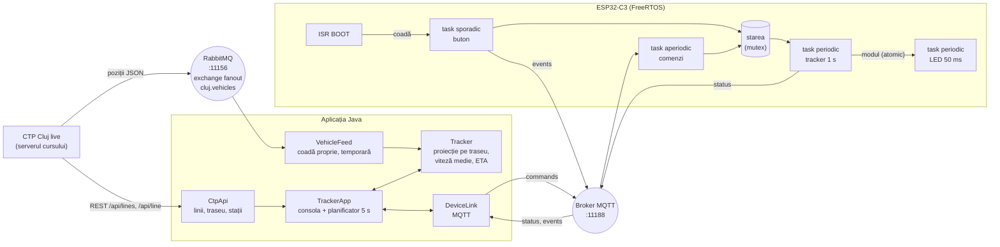

# Tema 04 – Tracker personal de autobuz (soluție)

**Student:** Istoc Iustin (`STUDENT = istoc-iustin`)

Utilizatorul alege în aplicația Java linia, sensul și stația lui și cât îi ia să meargă până la ea. Aplicația urmărește în timp real vehiculele liniei, estimează cel mai apropiat autobuz care încă nu a trecut de stație și îi trimite plăcii **în câte secunde trebuie să plece utilizatorul de acasă**. Placa arată asta pe LED. Când utilizatorul urcă în autobuz, apasă **BOOT**, iar aplicația înregistrează urcarea și oprește urmărirea.

## Arhitectura



### Ce calculează aplicația și ce calculează placa

- **Aplicația Java** face tot ce are nevoie de date: proiectează pozițiile pe traseu, alege autobuzul, estimează sosirea și scade timpul de mers pe jos. Ea are traseul, toată flota și memoria.
- **Placa** primește doar numerele finale și decide singură **modul** (ce arată LED-ul). Între două comenzi, care vin la 5 s, își scade singură timpul rămas, ca LED-ul să treacă exact la timp în „pleacă acum”. Dacă nu mai primește comenzi, arată că datele sunt vechi.

### Estimarea sosirii (`Tracker`)

Sursa nu are orare și nici estimări de sosire, așa că aplicația le calculează singură:

1. Traseul sensului ales (`shape` din `/api/line`) devine o linie frântă. Fiecare poziție de vehicul și fiecare stație se **proiectează** pe ea. Așa se obține distanța parcursă de la capăt. Distanța rămasă este *abscisa stației − abscisa vehiculului*.
2. **Viteza medie** a fiecărui vehicul se învață din pozițiile lui succesive (medie exponențială, include opririle). Până la a doua poziție se folosește 18 km/h. Valoarea e limitată la 9–43 km/h.
3. Între poziții (vin cam la 20 s), vehiculul este avansat cu viteza lui: *ETA = distanța rămasă / viteză*.
4. Se alege vehiculul cel mai apropiat care nu a trecut de stație (mai mult de 60 m după ea). Sub 80 m, autobuzul este „în stație”.
5. *plecare = ETA − timpul de mers pe jos*.

Imperfecțiunile datelor reale sunt tratate explicit:

| Problemă | Tratare |
|----------|---------|
| poziții vechi | ignorate după 3 minute; vehiculele fără poziție nouă 3 minute sunt scoase |
| vehicul pe celălalt sens (`trip_id` diferit) | scos din urmărire |
| `trip_id` lipsă | acceptat doar după ce s-a văzut mergând cel puțin 100 m în sensul ales |
| GPS departe de traseu (> 150 m), la depou | poziția este ignorată |
| traseu care trece de două ori prin același loc | la proiecție, dintre segmentele la fel de apropiate se alege cel mai apropiat de poziția anterioară |
| aceeași poziție primită de mai multe ori | ignorată (nu e mai nouă decât ultima) |
| `route_id` lipsă, JSON stricat | mesaj ignorat, aplicația continuă |
| prima stație (capătul) | nu poate fi aleasă: acolo autobuzul pleacă, nu sosește |

## Mesajele MQTT

Brokerul `control.aut.utcluj.ro:11188`, topic-urile sub `ssatr/istoc-iustin/devices/<deviceId>/`.

| Topic | Direcție | Conținut | Când |
|-------|----------|----------|------|
| `commands` | Java → placă | `TRACK;<linie>;<etaS>;<plecareS>;<stații>;<distM>` | la 5 s, cât timp există un autobuz spre stație |
| `commands` | Java → placă | `NOBUS;<linie>` | la 5 s, cât timp nu există |
| `commands` | Java → placă | `IDLE` | la oprirea urmăririi |
| `commands` | Java → placă | `ACK;<vehicul>` | după `BOARDED`: aplicația confirmă urcarea |
| `status` | placă → Java | `<deviceId>;<timestamp>;<MOD>;<plecareS>` | la 5 s |
| `events` | placă → Java | `<deviceId>;<timestamp>;BOARDED` | la apăsarea BOOT, dacă se urmărește o linie |

Exemple:

```
TRACK;24B;540;240;6;2700      autobuzul ajunge în 9 min, 6 stații, 2,7 km; pleacă în 4 min
TRACK;24B;200;-100;2;950      a trecut momentul plecării: LED aprins continuu
TRACK;24B;0;-300;0;40         autobuzul este în stație
esp32-a1b2c3;1764000000000;SOON;95
esp32-a1b2c3;1764000012000;BOARDED
```

Aplicația descoperă singură placa, după primul mesaj `status` publicat sub `ssatr/istoc-iustin/devices/+/`. Dacă ai mai multe plăci, o fixezi cu `DEVICE_ID` în `config.properties`.

## LED-ul și butonul

| Mod | Când | LED |
|-----|------|-----|
| `IDLE` | nu se urmărește nimic | stins |
| `NOBUS` | linia aleasă, dar niciun autobuz spre stație | un flash scurt la 3 s |
| `STALE` | de 30 s nu a mai venit nicio comandă (aplicația sau rețeaua s-a oprit) | două flash-uri la 2 s |
| `FAR` | mai mult de 2 minute până trebuie să pleci | clipire rară (200 ms la 2 s) |
| `SOON` | sub 2 minute până trebuie să pleci | clipire 2 Hz |
| `GO` | trebuie să pleci acum (sau ai întârziat) | aprins continuu |
| `ARRIVED` | autobuzul este în stație | clipire foarte rapidă |
| `BOARDED` | ai confirmat urcarea | trei flash-uri, 4 s, apoi stins |

Cu cât LED-ul e mai „agitat”, cu atât e mai urgent: rar, apoi 2 Hz, apoi continuu. Modurile fără autobuz sau fără date folosesc flash-uri scurte, ca să nu poată fi confundate cu cele de urgență.

**Butonul BOOT** înseamnă „am urcat în autobuz”. Apăsat în timpul unei urmăriri, trimite `BOARDED`, iar LED-ul confirmă imediat cu trei flash-uri. Aplicația notează vehiculul (cel estimat ca fiind cel mai apropiat), răspunde cu `ACK;<vehicul>` și oprește urmărirea. Apăsat fără o urmărire activă, butonul este ignorat (mesaj pe Serial).

## Taskurile de pe placă

| Activitate | Tip | Eliberare | Prioritate | Ce face |
|------------|-----|-----------|------------|---------|
| ISR buton | întrerupere | apăsarea BOOT (`FALLING`) | – | pune momentul apăsării în coada butonului și atât |
| buton | sporadic | apăsare; interval minim 1000 ms | 6 | respinge apăsările prea dese (și bounce-ul), marchează urcarea, publică `BOARDED` |
| LED | periodic | 50 ms | 5 | redă tiparul de clipire al modului curent |
| tracker | periodic | 1000 ms | 4 | scade local timpul rămas, decide modul, publică `status` la fiecare 5 joburi |
| comenzi | aperiodic | sosirea unei comenzi MQTT | 3 | parsează `TRACK`/`NOBUS`/`IDLE`/`ACK` și actualizează starea |

De ce așa:

- **Două taskuri periodice cu perioade diferite.** Tiparul LED-ului cere o rezoluție de 50 ms (flash de 50 ms, clipire de 150 ms), iar decizia de mod se schimbă cel mult o dată pe secundă. Un singur task la 50 ms ar recalcula de 20 de ori pe secundă același mod. Prioritățile urmează **Rate Monotonic**: perioada mai mică are prioritatea mai mare (LED > tracker). Ambele folosesc `xTaskDelayUntil` (eliberare absolută, fără derivă).
- **Comenzile sunt un task aperiodic.** Sosesc din rețea, la momente nesigure, fără un interval minim garantat. `command_received()` rulează pe taskul clientului MQTT, deci doar copiază textul în coadă (timeout 0). Taskul are prioritatea cea mai mică pentru că nu are un termen strict: tracker-ul acoperă oricum golurile cu numărătoarea locală.
- **Butonul este sporadic**, cu interval minim între sosiri de 1 s, impus de task. Momentul apăsării este pus în coadă de ISR, nu citit la preluare. Prioritatea maximă dă un răspuns imediat, iar intervalul minim îi limitează încărcarea.
- **Starea partajată** (urmărirea curentă: linie, ETA, plecare, stații, momentul ultimei comenzi, urcarea) este scrisă de taskul de comenzi și de cel al butonului și citită de tracker, deci e protejată de un **mutex**, ținut doar cât se copiază câmpurile. Nu se fac `Serial` sau `mqtt_publish()` cu mutexul luat. **Modul** curent are un singur octet, scris de tracker și citit de LED la fiecare 50 ms, deci e un `std::atomic<uint8_t>`.

## Rularea

### 1. Aplicația Java (`aplicatie-java/`)

```bash
cd aplicatie-java
cp config.example.properties config.properties   # completați cheia API și contul RabbitMQ
mvn -q compile exec:java
```

`config.properties` este în `.gitignore`. Cheia API și parola RabbitMQ nu ajung pe GitHub. Toate valorile se pot da și ca variabile de mediu (`CTP_API_KEY`, `RABBIT_USER`, `RABBIT_PASS` etc.).

Exemplu de sesiune:

```
Linia (ex. 24B, M26; q = ieșire): 24B
  1. spre Str. Unirii (31 stații)
  2. spre Disp. Grigorescu (30 stații)
Sensul: 1
   1. ...
Stația ta (număr sau nume): Mihai Viteazu
Minute de mers până la stație [5]: 4
[17:42:05] 24B → Piața Mihai Viteazu: vehiculul 1215, 2.7 km, 6 stații, sosește în ~9 min 0 s, pleacă în 5 min 0 s | placa esp32-a1b2c3: FAR
...
[17:51:12] URCARE CONFIRMATĂ: linia 24B, stația Piața Mihai Viteazu, vehiculul 1215
```

### 2. Placa (`esp32_tracker/`)

Arduino IDE, placa **ESP32C3 Dev Module**, *USB CDC On Boot: Enabled*. În `config.h`: `STUDENT` (identic cu aplicația) și rețeaua Wi-Fi. Pe GitHub rămâne rețeaua `iot-demo`. `connection.h` și `connection.cpp` sunt cele din temele 02 și 03, nemodificate. Serial Monitor la 115200 baud arată schimbările de mod, comenzile și apăsările.

### 3. Verificare fără placă

Din MQTTX, publicați pe `ssatr/istoc-iustin/devices/manual/status` mesajul `manual;0;IDLE;0`. Aplicația adoptă `manual` drept placă, iar comenzile ei apar pe `.../manual/commands`. Publicați apoi `manual;0;BOARDED` pe `.../manual/events` ca să simulați butonul.
